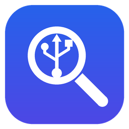
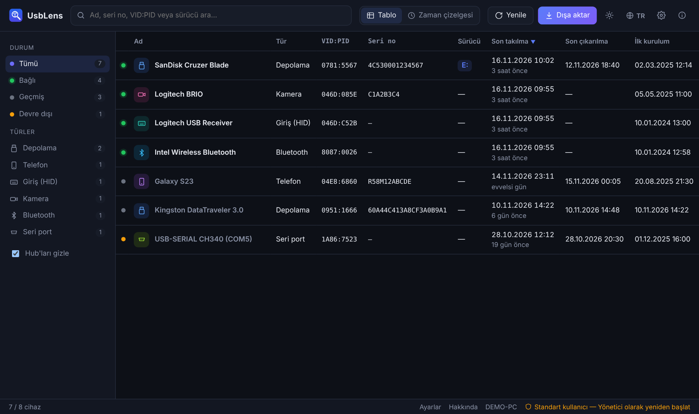
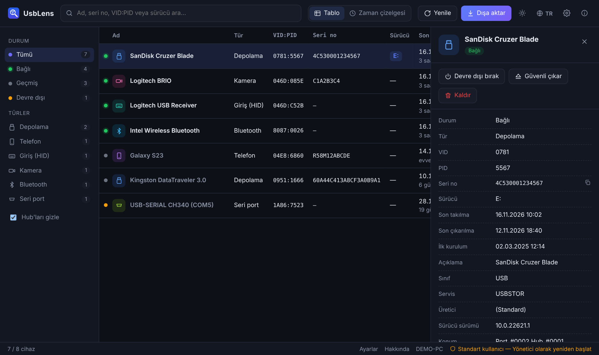
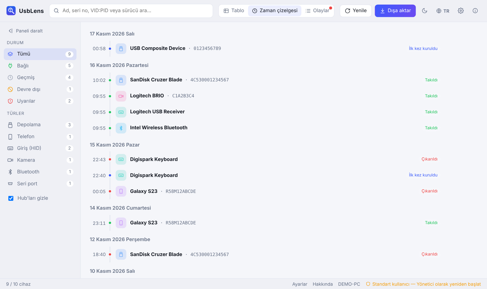
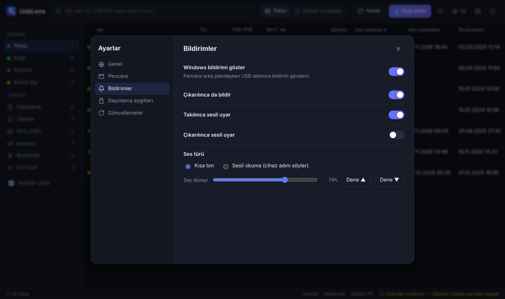
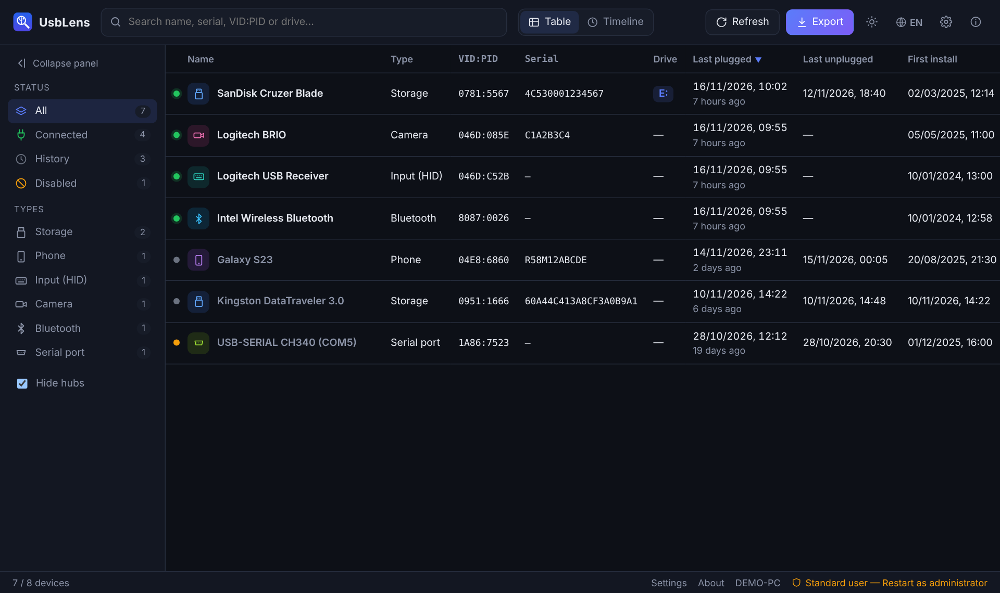
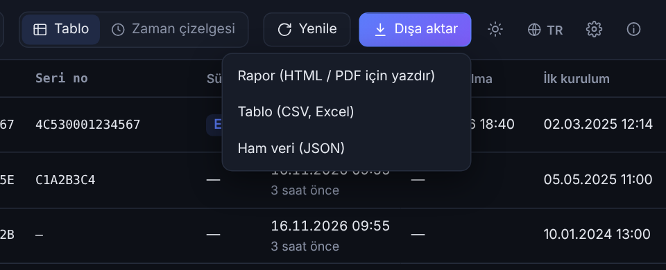
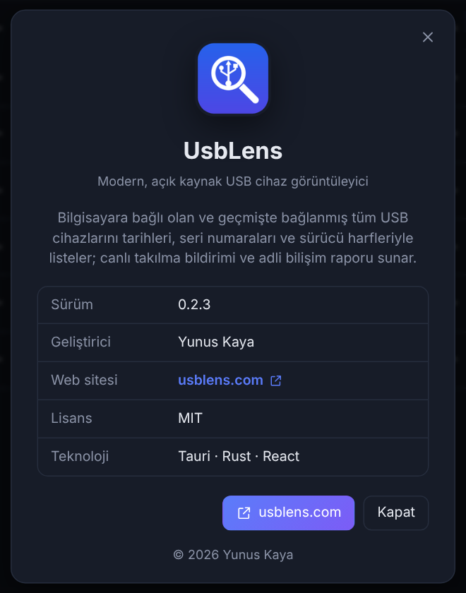
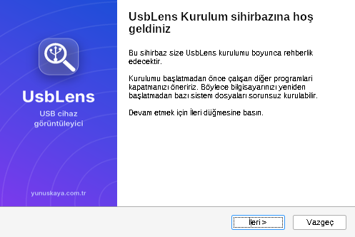

<p align="center">
  
</p>

<h1 align="center">UsbLens</h1>

<p align="center">
  USBDeview'den ilham alan, modern arayüzlü, açık kaynak <b>Windows USB cihaz görüntüleyici</b>.<br/>
  <i>A modern, open-source USB device viewer for Windows, inspired by NirSoft USBDeview.</i>
</p>

<p align="center">
  <a href="https://github.com/yunuskayax/USBLens/releases/latest"></a>
  <a href="https://github.com/yunuskayax/USBLens/actions/workflows/build.yml"></a>
  
  <a href="LICENSE"></a>
</p>

<p align="center">
  <a href="https://github.com/yunuskayax/USBLens/releases/latest"><b>⬇ İndir</b></a> ·
  <a href="#özellikler">Özellikler</a> ·
  <a href="#ekran-görüntüleri">Ekran görüntüleri</a> ·
  <a href="#geliştirme">Geliştirme</a> ·
  <a href="https://usblens.com"><b>usblens.com</b></a>
</p>

<p align="center">
  
</p>

Bilgisayara şu an bağlı olan ve **geçmişte bağlanmış** tüm USB cihazlarını tarihleri, seri numaraları
ve sürücü harfleriyle listeler. Canlı takılma bildirimi verir ve adli bilişim için raporlanabilir çıktı üretir.

## Özellikler

- **Liste, arama, filtre:** Bağlı / geçmiş / devre dışı, cihaz türü (depolama, telefon, HID, kamera…), anlık arama (ad, seri no, `VID:PID`, sürücü harfi). Sütunlara tıklayarak sıralama.
- **Tarihler:** İlk kurulum, son takılma, son çıkarılma (Windows PnP özelliklerinden).
- **Zaman çizelgesi:** Hangi gün hangi cihazın takıldığını / çıkarıldığını gün gün gösterir.
- **Cihaz işlemleri:** Etkinleştir / devre dışı bırak, güvenli çıkar, kaldır (geçmiş kayıtlar dahil).
- **Canlı bildirim:** USB takılınca / çıkarılınca uygulama içi uyarı, Windows bildirimi ve sesli uyarı (kısa ton veya cihaz adını sesli okuma).
- **Dışa aktarma:** HTML rapor (yazdır → PDF), CSV (Excel uyumlu, Türkçe karakterli) ve JSON. Rapora bilgisayar adı, kullanıcı, zaman damgası ve **SHA-256** özeti eklenir.
- **Ayarlar:** Her zaman üstte, kapatınca sistem tepsisine küçült, Windows ile başlat, küçültülmüş başlat; depolama aygıtı takılınca uygulamayı öne getir / sürücüyü Gezgin'de aç; açılışta güncelleme denetimi.
- Sistem tepsisi simgesi (Göster / Ayarlar / Çıkış), tek örnek çalışma.
- Daraltılabilir kenar çubuğu (`Ctrl+B`), koyu / açık tema, Türkçe / İngilizce arayüz, `Ctrl+F` arama, `F5` yenile.

## Ekran görüntüleri

<table>
  <tr>
    <td width="50%"><br/><sub><b>Cihaz ayrıntıları ve işlemler</b> — seri no, VID/PID, tarihler, devre dışı bırak / güvenli çıkar / kaldır</sub></td>
    <td width="50%"><br/><sub><b>Zaman çizelgesi</b> (açık tema) — hangi cihaz ne zaman takıldı / çıkarıldı</sub></td>
  </tr>
  <tr>
    <td width="50%"><br/><sub><b>Ayarlar</b> — bildirimler, sesli uyarı, pencere, depolama aygıtları, güncellemeler</sub></td>
    <td width="50%"><br/><sub><b>English UI</b> — Türkçe / İngilizce arayüz</sub></td>
  </tr>
  <tr>
    <td width="50%"><br/><sub><b>Dışa aktarma</b> — HTML rapor, CSV, JSON</sub></td>
    <td width="50%" align="center"><br/><sub><b>Hakkında</b></sub></td>
  </tr>
</table>

> Ekran görüntüleri örnek (demo) veriyle alınmıştır.

## Kurulum

[Releases](https://github.com/yunuskayax/USBLens/releases/latest) sayfasından indirin:

- **`UsbLens_x.y.z_x64-setup.exe`** — kurulum dosyası (önerilen)
- **`UsbLens_x.y.z_x64_tr-TR.msi`** — kurumsal dağıtım için MSI

<p align="center"></p>

Kurulum yönetici izni istemez (kullanıcı başına kurulur), Türkçe ve İngilizce arayüzlüdür.
Gereksinim: Windows 10/11 ve WebView2 (Windows 11'de hazır gelir).

İmzasız sürümlerde SmartScreen uyarısı çıkabilir: *Ek bilgi → Yine de çalıştır*.

## Kod imzalama

Windows sürümleri GitHub Actions'ta derlenip imzalanır; ayrıntılar ve kurulum için
[docs/KOD-IMZALAMA.md](docs/KOD-IMZALAMA.md), politika için [CODE_SIGNING_POLICY.md](CODE_SIGNING_POLICY.md).

Free code signing provided by [SignPath.io](https://signpath.io), certificate by [SignPath Foundation](https://signpath.org)
*(SignPath Foundation programına kabul edildikten sonra geçerlidir).*

## Mimari

```
src/                 React + TypeScript arayüz (Vite)
src-tauri/src/
  lib.rs             Tauri komutları (list_devices, set_device_enabled, eject_device, export_devices…)
  model.rs           Ortak veri modeli, VID/PID/seri ayrıştırma, sınıflandırma (+ birim testleri)
  export.rs          CSV / JSON / HTML rapor üretimi
  platform/win.rs    Windows arka ucu: SetupAPI + CfgMgr32 (windows-sys)
  platform/mock.rs   Windows dışı sistemler için örnek veri (arayüz geliştirme)
```

Windows tarafında veri şu kaynaklardan gelir:

| Ne | Nasıl |
|---|---|
| Cihaz listesi (geçmiş dahil) | `SetupDiGetClassDevsW("USB" / "USBSTOR")`, `DIGCF_PRESENT` olmadan |
| Ad, sınıf, servis, tarihler | `SetupDiGetDevicePropertyW` + `DEVPKEY_Device_*` (`FirstInstallDate`, `LastArrivalDate`, `LastRemovalDate`, `IsPresent`, `ConfigFlags`…) |
| Sürücü harfi | `\\.\X:` → `IOCTL_STORAGE_GET_DEVICE_NUMBER` ↔ disk arayüzü → `CM_Get_Parent` ile USB üst cihazı |
| Devre dışı / etkin | `DIF_PROPERTYCHANGE` (`DICS_ENABLE` / `DICS_DISABLE`) |
| Kaldır | `DiUninstallDevice` |
| Güvenli çıkar | `CM_Request_Device_EjectW` |
| Canlı izleme | `CM_Register_Notification` (`GUID_DEVINTERFACE_USB_DEVICE`) → `usb-event` |

> Tarih özellikleri (`LastArrivalDate` vb.) Windows 8 ve sonrasında vardır. Uygulama Windows 10/11 hedefler.

## Geliştirme gereksinimleri

- Windows 10/11
- [Rust](https://rustup.rs) (stable, MSVC araç zinciri) ve Visual Studio C++ Build Tools
- Node.js 20+
- WebView2 (Windows 11'de hazır gelir)

## Geliştirme

```bash
npm install
npm run tauri dev       # geliştirme
npm run tauri build     # kurulum dosyası: src-tauri/target/release/bundle/{nsis,msi}
```

Sadece arayüz üzerinde çalışmak için (Windows gerekmez, örnek veriyle açılır):

```bash
npm run dev             # http://localhost:1420
```

Testler ve Windows kodunu başka bir işletim sisteminde tip kontrolü:

```bash
cd src-tauri
cargo test
RUSTFLAGS="--cfg usblens_check" cargo check   # win.rs'i Linux/macOS'ta derler (bağlamadan)
```

## Güncelleme denetimi

Uygulama yeni sürümü doğrudan **GitHub Releases** üzerinden kontrol eder: en son yayınlanmış
Release'in etiketindeki sürüm numarasını (`v0.2.3` gibi) yüklü sürümle karşılaştırır, yeni sürüm
varsa Release notlarını ve `UsbLens-setup.exe` indirme bağlantısını gösterir.
Yeni sürüm çıkarmak için `vX.Y.Z` etiketli bir Release yayınlamak yeterli; kurulum dosyaları otomatik eklenir.

GitHub'a ulaşılamazsa yedek olarak `https://usblens.com/latest.json` ([`site/latest.json`](site/latest.json)) okunur.

Güvenlik için uygulama yalnızca `usblens.com`, `yunuskaya.com.tr` ve `github.com` bağlantılarını açar.
Ayarlar `%APPDATA%\\com.yunus.usblens\\settings.json` dosyasında saklanır.

## Yönetici yetkisi

Listeleme ve güvenli çıkarma standart kullanıcıyla çalışır. **Devre dışı bırakma ve kaldırma** yönetici
yetkisi ister. Alt çubuktaki "Yönetici olarak yeniden başlat" bağlantısı uygulamayı UAC ile yeniden açar.

## Yol haritası

- [ ] WPD (MTP telefon) ve Bluetooth cihazları için ek numaralandırma
- [ ] `setupapi.dev.log` ayrıştırma (kayıt defteri temizlenmiş olsa bile ilk takılma tarihi)
- [ ] Uzak bilgisayar / çevrimdışı kayıt defteri (`SYSTEM` hive) inceleme
- [ ] Beyaz liste: yalnızca izinli seri numaralarına izin ver, diğerlerinde uyar
- [ ] Doğrudan PDF dışa aktarma, imzalı rapor

## Web sitesi

**https://usblens.com** — tanıtım sitesi `site/` klasöründe ve GitHub Pages ile yayınlanır. Alan adı kurulumu: [docs/ALAN-ADI.md](docs/ALAN-ADI.md).

## Geliştirici

Yunus Kaya — [yunuskaya.com.tr](https://yunuskaya.com.tr)

## Lisans

MIT
